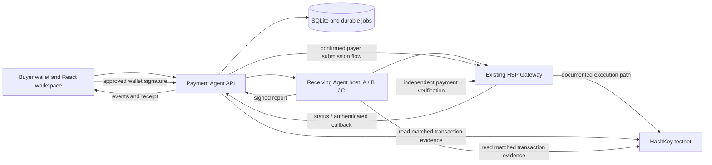

# ProofBid — Architecture and Workflow Specification

Version 2.0 · Companion to [PRD](prd.md) and [execution plan](implementation.md)

## 1. Decisions

| Area | Decision | Why / limit |
| --- | --- | --- |
| Backend | One Node.js TypeScript Fastify service | Sessions, private integration credentials, durable state, stream and reconciliation are needed |
| Persistence | SQLite, prepared SQL and versioned SQL migrations; local persistent disk | Small single-instance workload; no ORM or distributed database needed |
| Worker | Durable jobs table processed by the API process | No Redis, Kafka, separate scheduler or queue service |
| Agent boundary | One separate vendor host with 3 configured identities and HTTP routes | Actual network messages and signatures; few processes |
| Frontend | React + Vite + TypeScript; wagmi/viem; plain CSS | One interactive workspace; SSR and Next.js server features are unnecessary |
| Notifications | SSE from persisted events, polling fallback | Browser primarily receives updates; no WebSocket layer needed |
| Chain library | viem in browser and server | Shared typed encoding, signature and receipt utilities |
| Validation | Versioned static JSON Schemas and generated/shared TypeScript types | Fastify input/output schemas; reject unknown payment fields |
| Tests | Vitest for logic/integration; Playwright for browser | Real recovery/negative cases; no arbitrary coverage gate |
| Deployment | Single persistent host; API serves built UI; vendor process on same/private host initially | Same origin simplifies sessions; SQLite is not deployed to ephemeral serverless storage |
| Contracts | None required in P0; optional audit anchor in P1 | Existing HSP executes payment; avoid custody and slashing scope |

Use a supported Node LTS compatible with the HSP SDK after receiving it; pin the exact runtime and dependency versions in Phase 0 rather than assuming an unavailable SDK works with a chosen version. Pin a current SQLite build and check security advisories before enabling WAL. Upgrade to Postgres and a separately leased worker only when concurrent writers or replicas are actually needed.

Fastify supports compiled request/response schemas ([official reference](https://fastify.dev/docs/latest/Reference/Validation-and-Serialization/)). SQLite WAL permits concurrent readers with a single writer and requires a shared local host ([official reference](https://www.sqlite.org/wal.html)). These properties support this design; they are not measured ProofBid throughput claims.

## 2. System boundary



This diagram describes the target **gateway-executes** integration. The alternative HSP Coordinator SDK described in the local HSP guide is wallet-broadcast and observation-based. It changes the payment executor boundary and must be approved as the chosen track surface before use. See [integration gate](docs/planning/hsp-integration.md). Implement one live profile after discovery, plus the local simulator; do not build both speculatively.

The vendor host owns its merchant app credentials and merchant authorization key. The buyer API never impersonates an unrelated merchant. For the demo the same operator may provision all vendors, but configuration, keys and order ownership remain per vendor. If operations cannot provision three merchant apps/payees, use three quoting personas with one explicitly disclosed receiving merchant; do not claim independent settlement identities.

## 3. Repository layout and module ownership

```text
apps/
  api/src/
    app.ts                  # Fastify wiring; no domain rules
    config.ts               # validated environment and deployment profile
    auth/                   # wallet challenge, session, ownership and CSRF
    routes/                 # request/response mapping only
    services/               # RFQ, selection, approval, settlement, delivery
    db/                     # migrations, prepared queries, transaction helpers
    jobs/                   # lease, retry, recovery, provider reconciliation
    events/                 # append and SSE replay
    providers/hsp/          # selected real profile and explicit simulator
    chain/                  # read-only payment evidence validation
  web/src/
    app/                    # providers, routing, top-level shell
    features/request/       # form, validation and RFQ lifecycle
    features/quotes/        # ranked comparison and selection
    features/payment/       # conditions diff, approval and wallet states
    features/receipt/       # payment evidence, report retrieval, export
    components/             # small shared buttons/status/drawer/table
  vendors/src/
    server.ts               # HTTP routes, vendor allowlist auth
    profiles.ts             # keys/config references, prices and fixtures
    orders.ts               # merchant cart signing/create/query if chosen profile
    settlement.ts           # recipient-side independent verification
    reports.ts              # real bounded report computation and signing
packages/domain/src/
  schemas/                  # RFQ, quote, conditions, draft, evidence and delivery
  quote.ts                  # exact EIP-712 type and verification
  canonical.ts              # RFC 8785 binding and integer money parsing
  ranking.ts                # pure eligibility-independent ordering
  policy.ts                 # spend, expiry, chain/token and fee predicates
  evidence.ts               # bundle schema, digest and verification result
fixtures/                   # small public datasets, golden vectors, API fixtures
scripts/                    # dev, seed, doctor, smoke, verify-bundle
contracts/                  # P1 only, absent until optional anchor begins
```

Maintain one domain package; avoid a package per class. Money and signature checks live in shared pure functions, not route handlers or React components. Vendor and buyer run the same schema/hash checks but make their own trust decisions.

## 4. Data conventions

- API protocol version `proofbid/2`; reject unsupported versions and extra authorization fields.
- IDs are cryptographically random 32-byte hex identifiers. Never use timestamp alone for uniqueness or secrecy.
- Addresses are validated, stored in one normalized form and compared by address value; UI uses checksum display.
- `chainId` is an allowed safe positive integer. P0 quantity must be 1 for the single-report SKU; later batch SKUs need separate validated limits and pricing. `amountBaseUnits`, token fees, caps and nonces use decimal integer strings; convert to BigInt internally. Enforce explicit bounds, positivity and token precision before conversion. Dates are UTC Unix seconds; database scheduling timestamps are UTC milliseconds with names ending `AtMs`.
- Hashes are `0x` plus exactly 64 hexadecimal digits. Signatures are validated hex with the expected EOA format. Smart contract wallet signatures are unsupported until EIP-1271/6492 verification is implemented and tested; show that limit before bidding.
- Canonical JSON uses RFC 8785 for our JSON digests. No floats are accepted in economic fields. HSP/cart/authorization hashing follows the selected HSP protocol exactly, not our own serializer by assumption.
- Never label an RFQ hash, quote digest, HSP mandate hash and transaction hash as interchangeable. Each has its own domain and meaning.

## 5. RFQ and canonical signed quote

RFQ immutable fields: `protocolVersion, deploymentId, rfqId, buyer, chainId, token, sku, skuVersion, inputHash, quantity, maxRecipientAmountBaseUnits, maxTotalDebitBaseUnits, maxNativeGasWei, maxDeliverySeconds, collectionClosesAt, createdAt`.

`rfqHash = keccak256(UTF8(RFC8785(immutableRfq)))`. The buyer verifies the form summary before RFQ creation; session ownership binds the request to its wallet. The RFQ itself is not a spend authorization. Late bids are stored as rejected evidence, not included in ranking.

EIP-712 domain for vendor quotes:

```text
name = ProofBidQuote
version = 2
chainId = configured chain
salt = configured random deploymentId (bytes32)
```

An off-chain quote domain need not invent a `verifyingContract`. If the P1 anchor uses a different domain, introduce a new explicit quote version and migration test; never silently change domain interpretation for stored signatures.

Exact primary type `Quote`, in this field order:

| Field | EIP-712 type | Rule |
| --- | --- | --- |
| rfqId | bytes32 | Existing RFQ |
| rfqHash | bytes32 | Exact immutable RFQ digest |
| quoteId | bytes32 | Unique per deployment |
| buyer | address | RFQ owner and payer |
| vendorSigner | address | Configured receiving agent signer |
| payee | address | Trusted vendor payout, may differ from signing address only if configured |
| token | address | Exact configured token |
| amountBaseUnits | uint256 | Positive exact amount to payee |
| quantity | uint256 | Same as RFQ |
| skuHash | bytes32 | Hash of versioned SKU string |
| inputHash | bytes32 | Fixture bytes digest |
| termsHash | bytes32 | Digest of canonical service terms |
| issuedAt | uint64 | Not materially in the future |
| validUntil | uint64 | Within bounds and after signing/submission headroom |
| nonce | bytes32 | Unique random vendor quote nonce |

`quoteDigest = hashTypedData(domain, types, quote)`. This is the canonical offer binding; no second hand-written packed `bidHash` formula. Include signatures as opaque hex; use viem verification with expected signer and reject malformed/noncanonical signatures as supported by the library. Save cross-language/golden vectors before building dependent modules.

Terms JSON: `schemaVersion, sku, skuVersion, inputHash, reportSchemaVersion, analyzerVersion, deliveryWithinSeconds, permittedUse`. Hash exact canonical bytes. A promised delivery duration is not a measured latency claim. Recipient payout and identity changes require new trusted configuration plus a new quote; a vendor-signed arbitrary payee is not automatically allowed.

Validate in order: transport/body/schema → environment/RFQ ownership → configured vendor signer/payee → signature/domain → RFQ/SKU/input/quantity → terms preimage/hash → positive amount/budget/token → timing → unique quote ID/digest. Do not rank invalid quotes.

P0 ranking: ascending amount, then deliveryWithinSeconds, then vendorSigner address bytes, then quoteDigest. Price ties never depend on arrival order or JavaScript locale. One current quote per vendor/RFQ; a changed quote is an explicit revision before selection, never an excuse for changing selected conditions. RFQ collection closes once, transactionally.

## 6. Payment conditions and immutable preparation

Buyer calls the allowlisted vendor's conditions endpoint with `rfqId, quoteId, quoteDigest` and a request correlation ID. Vendor returns the original signed quote, canonical terms, a conditions digest and, when needed, its merchant-signed cart/order reference. Authenticated service calls use a per-peer credential with replay protection; the quote remains verifiable independently of that credential.

Compare all economic/identity/service values with the chosen quote. Do not accept a same-price different payee, a label-only token match, an unbound input, or an expired reissued condition. Persist mismatches and stop. Attack mode may return corrupted conditions, but this does not itself prove the vendor signed the mutation.

Internal `PreparedPayment` fields (our model, **not a claimed HSP wire schema**):

```text
attemptId, attemptNo, rfqId, quoteDigest, conditionsDigest,
providerProfile, providerVersion, environment, deploymentId, chainId,
payer, payee, token, tokenDecimals, recipientAmountBaseUnits,
payerMaxDebitBaseUnits, tokenFeeBreakdown, maxNativeGasWei,
authorizationValidUntil, trustPolicyHash, providerOrderIds,
wirePayloadHash, walletSigningDescriptor, preparationExpiresAt,
requestVersion, policyVersion
```

`approvalDigest = keccak256(UTF8(RFC8785(preparedPaymentPublicSnapshot)))`. Exclude neither fees nor execution targets from the public approval snapshot. `walletSigningDescriptor` contains the actual protocol domain/types/message and any required execution descriptor, not a string describing it. Normalize away no semantically meaningful provider field.

The real adapter must prove that the wallet authorization and gateway order cryptographically bind the material payment fields. The internal approvalDigest is a versioned audit/consent correlation value, not automatically a buyer-signed ProofBid approval. When the HSP format has no quote-binding extension, the proof bundle must label the quote-to-payment association as locally checked; it cannot claim a buyer signature over our RFQ/SLA hash. A separate buyer-signed ProofBidApproval is a possible P1 feature if that portable guarantee justifies another wallet prompt. Our database mapping to quoteDigest provides audit correlation, not gateway-enforced procurement/SLA rules. A mandate metadata field is optional only if documented; never add invented metadata to an HSP payload.

If an SDK combines construction, signing and execution in `pay()`, inspect it first. Use its supported separated steps or controlled signer callback to inspect/check the exact payload before signing and record it before submission. Do not allow an opaque convenience call to bypass the approval and recovery boundary.

Freeze and persist preparation before signing. `POST /api/attempts/:id/approve` first reserves cap exposure atomically and returns the exact approved signing descriptor. Only then request the wallet signature; `authorize` records/verifies that signature and dispatches the existing attempt. An interrupted signature round-trip remains reserved until it is safely resolved, never freed merely by a browser timeout. A changed wallet account, network, terms, provider requirements, total fees, token or authorization requires a new preparation version and explicit approval. Validate again at signature acceptance and immediately before dispatch. Do not mutate signed artifacts in place.

## 7. Live provider interface and integration ownership

These method names are internal design contracts:

```ts
interface PaymentProvider {
  discover(): Promise<DeploymentCapabilities>;
  prepare(input: VerifiedConditions): Promise<PreparedProviderPayment>;
  validateSigned(input: SignedProviderPayment): Promise<ValidationResult>;
  submit(input: PersistedAttempt): Promise<SubmissionResult>;
  reconcile(input: PersistedAttempt): Promise<ObservedPayment>;
  verifyEvidence(input: ObservedPayment): Promise<VerifiedSettlement>;
}
```

Persist `PreparedProviderPayment` and raw provider response snapshots privately with content hashes and redaction rules. `SubmissionResult` can be `known`, `rejected`, or `unknown`; it cannot collapse transport timeouts into rejection. The provider must expose whether any already issued authorization can still execute. The app never creates a custom transfer fallback.

For the merchant profile, the receiving agent signs its Cart Mandate using ES256K and calls merchant order/query APIs using its own HMAC credentials. Buyer wallet signing and payer submission use the organizer-confirmed payer SDK/API. The backend is a narrowly allowlisted proxy only where required; arbitrary paths, hosts and caller-supplied API credentials are forbidden. For the Coordinator alternative, team write credentials stay server-side and settlement is wallet-broadcast as documented; do not call that gateway-executed.

No live profile is enabled until [the integration checklist](docs/planning/hsp-integration.md) is complete. The simulator has the same internal contract, deterministic state transitions and controllable failures; its IDs use `local:` and it never emits a fake explorer link.

## 8. Persistence, indexes and transactions

Use explicit SQL migrations with foreign keys on, WAL, `synchronous=FULL`, bounded `busy_timeout` and short transactions. Acknowledge paid operations only after durable commit. Network calls never run inside an open write transaction. Large JSON/crypto work stays bounded; a worker thread is added only if profiling shows blocking.

| Table | Key content and constraints |
| --- | --- |
| deployments | Profile/version, chain/token/decimals, trusted gateway/adapter/issuer addresses, policy hash; immutable once used |
| auth_challenges | Unique random nonce hash, domain/URI/chain/address, expiresAtMs, consumedAtMs |
| sessions | Opaque token hash, buyer, deployment, expiry; never a payment permission |
| rfqs | Unique rfqId, buyer/session owner, canonical JSON/hash, phase, version, collection deadline |
| quotes | Unique quoteDigest and quoteId per deployment; RFQ FK, signer, signed bytes, terms, rejection reason; index rfqId |
| attempts | Unique (rfqId, attemptNo), quote FK, exact preparation/signature, version, normalized state, timestamps |
| provider_refs | Unique (deploymentId, namespace, providerId); attempt FK; do not conflate merchant and Coordinator IDs |
| payment_evidence | Attempt, raw/status digest, chainId, txHash, blockHash, log index and normalized matched facts |
| spend_ledger | Attempt/payer/asset, reserved/committed amounts, reserved and settled timestamps; unique reservation per attempt/asset |
| events | Monotonic integer ID, RFQ/attempt, event type, sanitized payload, occurredAtMs; index (rfqId, id) |
| jobs | Unique (attemptId, kind, version), dueAtMs, attempts, leaseOwner, leaseUntilMs, lastError; index due/status |
| callback_inbox | Unique provider event ID if defined, otherwise hash of provider identity + raw verified body; raw digest and processing state |
| deliveries | Unique quoteDigest and attemptId; artifact digest, signature, bytes/path, verification result; private read access |
| idempotency | Unique (buyer, route, key), canonical request hash, response/status reference and retention |

Create a partial unique index allowing at most one unresolved/executable attempt per RFQ. Terminal unpaid states count as releasable only after authorization revocation/expiry/consumption has been reconciled. Use `BEGIN IMMEDIATE` for selection, approval/spend reservation and job claim; compare-and-swap the RFQ/attempt version. A duplicate idempotency key with changed request bytes returns 409. Different keys do not defeat the one-active-attempt and spent-order constraints.

On a state change, update attempt/RFQ, append event and enqueue/complete job in the same transaction. Publish SSE after commit; persisted events allow replay after process failure. Job leases expire after crash. The next worker reconciles external state before repeating any side effect.

The buyer approval cannot make remote submission and local persistence atomic. Mitigate by persisting stable external IDs/nonces and signed bytes before sending; reconcile those identifiers after any unknown response. Without provider idempotency or an authoritative query/revocation path, stop for manual reconciliation rather than promise exactly-once delivery.

## 9. State and transition rules

RFQ states: `DRAFT → COLLECTING → READY → IN_PROGRESS → COMPLETED`. Alternatives: `NO_VALID_QUOTES`, `CANCELLED`, `EXPIRED`. Selected attempts carry the detailed lifecycle; the RFQ is not marked failed when a payment is merely uncertain.

| Attempt state | Permitted next state / action |
| --- | --- |
| VALIDATING_CONDITIONS | PREPARING or REJECTED_UNPAID |
| PREPARING | AWAITING_APPROVAL or REJECTED_UNPAID |
| AWAITING_APPROVAL | RESERVED_AWAITING_SIGNATURE, USER_REJECTED, EXPIRED_UNPAID |
| RESERVED_AWAITING_SIGNATURE | AUTHORIZED; explicit known user rejection before signature can close unpaid, but an uncertain signing round-trip stays reserved until reconciled/expired under policy |
| AUTHORIZED | SUBMITTING; no second attempt while authorization executable |
| SUBMITTING | PENDING, SUBMISSION_UNKNOWN, REJECTED_PENDING_RECONCILIATION |
| SUBMISSION_UNKNOWN | PENDING, SETTLED_VERIFIED, UNPAID_CLOSED or MANUAL_REVIEW |
| REJECTED_PENDING_RECONCILIATION | UNPAID_CLOSED only after authorization no longer executable; otherwise manual review |
| PENDING | INCLUDED, SUBMISSION_UNKNOWN, UNPAID_CLOSED or MANUAL_REVIEW |
| INCLUDED | FINALITY_WAIT, PENDING on reorg, or MANUAL_REVIEW on mismatch |
| FINALITY_WAIT | SETTLED_VERIFIED when all evidence and finality predicates pass; PENDING on reorg |
| SETTLED_VERIFIED | DELIVERY_PENDING |
| DELIVERY_PENDING | FULFILLED, DELIVERY_OVERDUE or DELIVERY_REJECTED |
| DELIVERY_OVERDUE / DELIVERY_REJECTED | DELIVERY_PENDING for same paid order, or FULFILLED after valid artifact |
| FULFILLED | Read/retrieve/export only; later detected evidence compromise creates an incident, never erases history |

`REJECTED_UNPAID`, `USER_REJECTED` and `EXPIRED_UNPAID` apply only when no executable payment authorization left the wallet/app. `UNPAID_CLOSED` requires recorded proof of unspendability after dispatch. If signatures may remain valid externally, expiry in our UI is insufficient. Pending spend reservations survive logout, process restart, policy-day rollover and user cancellation.

Cancellation stops future actions only; it does not cancel a signed authorization or mined payment. If provider revocation exists, invoke and confirm it before marking funds free. At most one paid purchase per RFQ is accepted by the app; a valid provider authorization that permits duplicate settlement is a live-mode blocker, not fixed by a local lock.

## 10. Settlement evidence and delivery gate

Vendor-side merchant order creation also persists stable cart/payment_request IDs before its external write. A timeout is reconciled using those same IDs; the vendor must not invent a fresh order on every conditions retry. Changed carts or order validity require a new prepared version and approval.

Merchant callback authentication uses the documented raw-body HMAC and timestamp, independent of HMAC request signing. Enforce body size, freshness, constant-time comparison, expected provider/app and known IDs; durably insert the inbox item before replying 2xx. A duplicate valid callback returns success without repeating delivery. Persist callbacks that arrive before local provider-reference recording and reconcile them after submission resolves. An authenticated callback is a wake-up signal, not final proof.

Reconcile authenticated gateway queries with the pinned chain RPC and execution protocol. Verify chain ID, transaction success, canonical block hash/finality, actual token contract, payer **from the correct transfer/authorization event**, destination, exact base-unit amount and the association of the execution with this mandate/order/nonce. A relayer's transaction `from` need not be the buyer. Do not credit arbitrary `Transfer` logs with matching addresses/amounts; tie them to the documented gateway execution or EIP-3009 authorization/Permit2 nonce and unique attempt. One `(chainId, txHash, logIndex)` cannot fulfil two orders.

Use the exact finality contract of the selected HSP deployment and RPC. Prefer protocol/chain finalized evidence; if unsupported, record the confirmed chain-specific policy and its residual reorg risk, rather than inventing a universal block count. No `SETTLED_VERIFIED` without the configured policy. The HSP Coordinator profile additionally verifies the mandate/receipt/attestation triple with pinned adapter and issuer policy; a status label alone is insufficient.

Vendor reads the same evidence through its own authenticated provider query and configured RPC/trust policy. It must verify buyer/order/quote/payment association independently of our claim. After success, compute the bounded dataset report and sign a separate EIP-712 `DeliveryReceipt` domain/version binding `quoteDigest, attemptId, inputHash, artifactHash, analyzerVersionHash, deliveredAt`. Persist once and reuse the same bytes on retrieval retries. Buyer verifies and independently recomputes the fixture result; network timing is not the proof of service quality.

Delivery timeout starts at the recorded verified-settlement timestamp according to the signed terms; process restarts do not reset it. Report artifacts are buyer-authorized reads; no report content or access credential appears in SSE, logs, URL query strings or public proof export.

## 11. Application routes and access

All routes below are ProofBid routes, not assertions about remote HSP endpoints. JSON responses include a correlationId and typed error code; errors never contain secrets or raw authorization bytes.

| Route | Role / semantics |
| --- | --- |
| GET /health/live, /health/ready | Liveness; sanitized DB/config/worker readiness |
| GET /api/config | Public deployment/mode, supported wallet/chain/token and caps; no secrets |
| POST /api/auth/challenge | Rate-limited one-use wallet sign-in nonce |
| POST /api/auth/verify | EIP-4361/SIWE verification; expected domain/URI/chain/address/expiry; consumes nonce |
| DELETE /api/auth/session | Clear session; does not cancel payments |
| POST /api/rfqs | Authenticated owner; Idempotency-Key required |
| GET /api/rfqs, /api/rfqs/:id | Owner-only bounded history/detail |
| GET /api/rfqs/:id/events | Owner-only SSE, Last-Event-ID replay and heartbeat |
| POST /api/rfqs/:id/select | Owner, quoteDigest, expectedVersion; conditions/preparation job |
| POST /api/attempts/:id/approve | Owner, approvalDigest, expectedVersion, Idempotency-Key; atomically reserve caps/freeze descriptor before wallet prompt |
| POST /api/attempts/:id/authorize | Owner, approvalDigest, expectedVersion, signature artifacts, Idempotency-Key; validate/record/dispatch already reserved attempt |
| POST /api/attempts/:id/reconcile | Owner; schedule safe status read, never a blind new payment |
| POST /api/rfqs/:id/cancel | Owner; records intent and explains any pending financial state |
| GET /api/attempts/:id/delivery | Owner-only verified artifact retrieval |
| GET /api/rfqs/:id/proof | Owner-only redacted bundle; attachment response, cache disabled |
| POST /api/hsp/callback | Provider-authenticated raw callback when supported by selected live profile |
| POST /internal/vendors/:id/rfq | Peer-authenticated RFQ, signed quote response |
| POST /internal/vendors/:id/conditions | Peer-authenticated original conditions and optional provider order |
| POST /internal/vendors/:id/fulfil | Peer-authenticated request; vendor independently verifies before delivery |

Use SameSite + Secure HttpOnly session cookies, explicit Origin/CSRF checks for mutations, wallet-owned access checks on every RFQ/attempt/artifact, limited JSON bodies, bounded list sizes and rate limits. Bind challenges to configured public origin; do not trust a Host header through an untrusted proxy. Session login signatures cannot authorize payments. Session expiry requires reauthentication for private reads/new mutations while durable reconciliation continues.

P0 vendors are operator allowlisted with fixed URLs and recipients. No user-supplied callback or vendor fetch URL: this prevents SSRF without building a general egress service. Demo scenario selection is a local/testnet-only protected run parameter signed into the run configuration; there is no unauthenticated global attack toggle or public reset endpoint.

## 12. Performance and operations

- Persist/acknowledge a request quickly, then fan out at most 3 concurrent vendor calls with AbortController deadlines. Each run has one collection-close job; late responses cannot reopen ranking.
- Poll provider status adaptively (initial 2 seconds, exponential backoff capped at 30 seconds with jitter), respecting Retry-After. Deduplicate poll and webhook-triggered reconciliation under the same attempt lease. Use explicit retry budgets and manual-review status; do not discard financial ambiguity when a retry budget ends.
- Cache immutable token metadata and trust config per deployment; revalidate on startup/config version change. Do not cache pending payment status as final.
- Index owner/history, RFQ quotes, active attempts, event cursors and due jobs. Bound evidence payload size and retention. SSE has heartbeat, reconnect cursor, connection cap and slow-client disconnect; browser can fetch the current snapshot after a cursor-retention gap.
- Log IDs, state transitions, latency and sanitized reasons. Redact cookies, bearer credentials, private keys, HMACs, raw signed payment artifacts and report contents. Record app processing vs gateway/chain/wallet time separately.
- Metrics: active/unknown attempts, oldest job, reconciliation error rate, blocked mismatch counts, time to quotes, gateway latency, settlement finality and delivery latency. A capped local benchmark tests 10 simultaneous RFQs / 30 vendor calls, not imaginary high TPS.
- Pin dependencies/lockfile. Provide `doctor`, migration, seed, start, smoke and proof verification commands. SIGTERM stops accepting mutations, finishes bounded DB work and releases jobs or lets leases expire; resume by reconciliation on startup.
- Store DB/artifacts on persistent local disk. Use SQLite's backup API or consistent backup tooling; copying only the DB while WAL is active is unsafe. Restore-test backups; keep credentials outside backups or encrypt separately. Never delete unresolved payment records for demo reset.

## 13. Optional audit anchor and mainnet boundary

P1 can add a non-upgradeable noncustodial `ProofBidAnchor` that records `(buyer, rfqId, attemptNo, quoteDigest, approvalDigest)`, called by the buyer or an explicitly approved relayer. Scope uniqueness by buyer + RFQ + attempt. It holds no funds, performs no HSP transfer and makes no claim to verify delivery or gateway settlement. Use events plus a minimal stored digest; signature-based relaying needs nonce/expiry/domain tests. See Solidity Security skill before implementing. No arbitration, bonds or fake view-function events.

Mainnet provisions a new deploymentId, database namespace, vendor allowlist, token/chain/protocol pins, credentials and caps. `ALLOW_MAINNET=false` by default; mainnet additionally requires a recorded release checklist and explicit operator activation. Simulators/test keys cannot enable it. Configuration is validated at startup and the UI states the actual provider mode. See execution plan for release gates.
